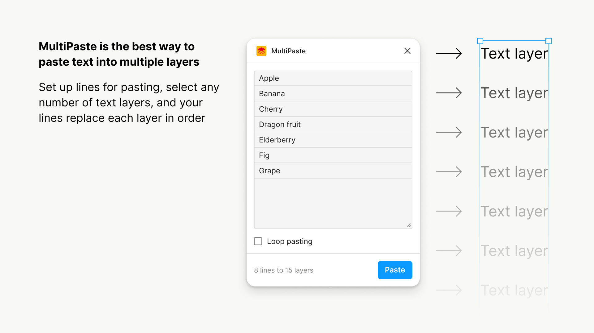

# MultiPaste

Paste lines of text into selected Figma text layers, in Figma's selection order.

Enable looping to repeat the lines across the layer selection. 

## Build and import

Requires Node.js, npm, and the Figma desktop app.

`npm ci`, `npm run build` compiles `code.ts` to `code.js`, which the manifest loads. The UI is plain HTML and JavaScript in `ui.html`, with Figma's light/dark theme colors.

## Develop

`npm run watch` for TypeScript changes to rebuild automatically. After saving changes to the code or UI, close and reopen the plugin in Figma. Run `npm run typecheck` to check the TypeScript without emitting JavaScript.
